## Hi I'm Hasan 👋

**Senior Software Engineer • 16+ Years • Enterprise Systems**

🚀 Building scalable backend services  
🔧 Java • Spring Boot • PostgreSQL • Kafka • AWS  
📊 Python • Spark • Airflow • Data Analytics

### 💻 Current Focus
High-performance microservices with integrated data processing

### 📍 Ankara, Türkiye

---
*"Turning complex problems into simple, robust solutions"*
